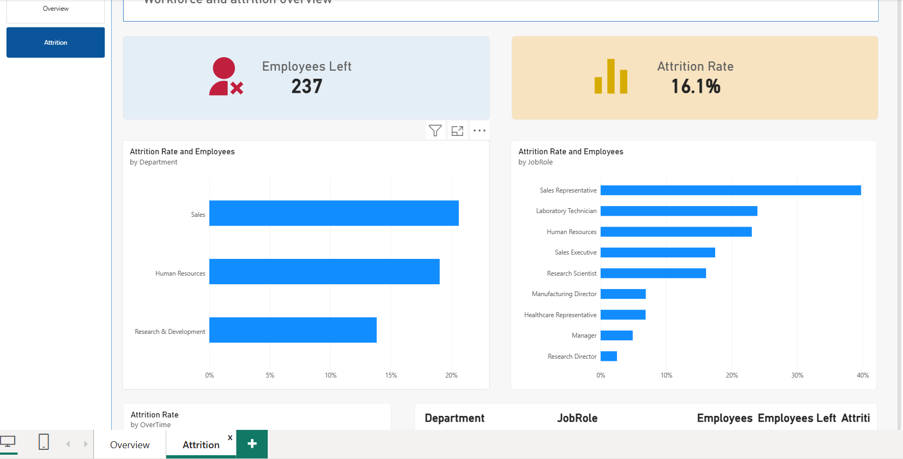
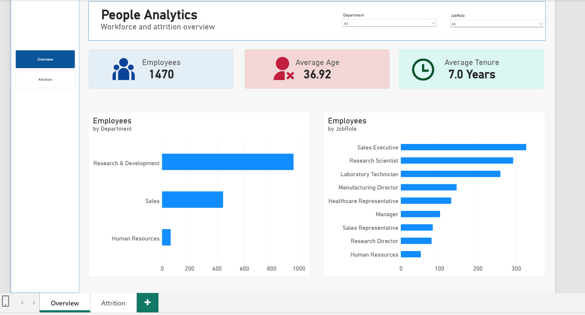
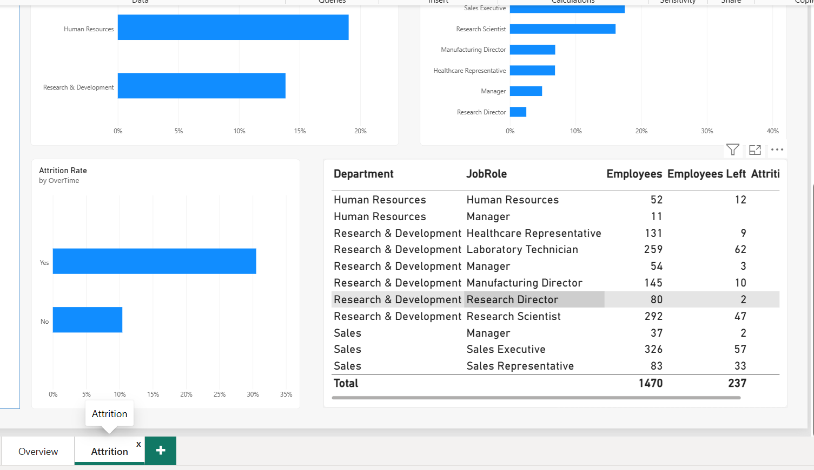

## Dashboard Preview

### Workforce Overview

### Employee Attrition

### Detailed Attrition Analysis

**HR Analytics & Employee Attrition Analysis**
**Project Overview**
This project explores workforce composition and employee attrition using a synthetic HR dataset containing 1,470 employee records.

The objective was to develop an interactive Power BI dashboard that helps HR teams understand workforce demographics, identify attrition patterns and highlight areas requiring further investigation.

**Tools Used: Power BI, Power Query, DAX**

Project Type: DataGene Data Analytics Portfolio Project

Dataset: IBM HR Analytics Employee Attrition & Performance (Synthetic Dataset)

Business Problem
Employee attrition can affect organisational stability, workforce planning and recruitment costs.

HR teams need visibility into employee distribution, attrition rates and the characteristics associated with employees leaving.

The challenge was to transform employee data into a clear, interactive report that could help HR teams identify patterns and prioritise further investigation.

What I Did
Imported and prepared employee data using Power Query, checking data types, missing values and duplicate employee identifiers.

Developed DAX measures for total employees, employees who left, attrition rate, average age and average tenure.

Created a two-page Power BI dashboard covering workforce overview and employee attrition.

Built interactive charts comparing employee counts and attrition rates across departments and job roles.

Analysed the relationship between overtime and employee attrition.

Implemented department and job role filters to support detailed analysis.

Validated calculations and presented the findings through accessible visualisations.

Dashboard Overview
The report contains two pages:

Page 1 — Workforce Overview

Displays total employees, average age, average tenure, employee distribution by department and job role.

Page 2 — Employee Attrition

Displays employees who left, overall attrition rate, attrition by department, attrition by job role and comparisons between employees who work overtime and those who do not.

Key Findings
1. Overall Employee Attrition

Out of 1,470 employees, 237 were recorded as having left, representing an overall attrition rate of 16.1%.

2. Departmental Attrition

The Sales department recorded the highest attrition rate at approximately 20.6%, followed by Human Resources at approximately 19.0%. Research & Development had the lowest rate at approximately 13.8%.

3. Job Role Attrition

Sales Representatives had the highest attrition rate at approximately 39.8%, with 33 employees leaving out of 83.

4. Overtime and Attrition

Employees working overtime had an attrition rate of approximately 30.5%, compared with approximately 10.4% among employees who did not work overtime.

This indicates a strong association between overtime and attrition within the sample, although it does not establish causation.

5. Workforce Overview

The dataset contains 1,470 employees, with an average age of 36.92 years and average tenure of 7.0 years.

Research & Development represents the largest department by employee count.

Business Recommendations
1. Investigate Attrition Among Sales Representatives

HR teams should examine potential contributors to the high attrition rate among Sales Representatives, including workload, performance expectations, compensation and employee feedback.

2. Review Overtime Patterns

The substantial difference in attrition rates between employees who work overtime and those who do not suggests that overtime patterns deserve further investigation.

3. Prioritise Department-Level Retention Analysis

HR teams should investigate retention challenges in Sales and Human Resources while comparing employee experiences across departments and job roles.

Solution Delivered
Developed a two-page interactive Power BI dashboard that consolidates workforce and attrition metrics into an accessible reporting experience.

The dashboard enables users to explore employee distribution, compare attrition patterns and identify workforce segments that may require closer attention.

Dataset Limitations
This project uses a fictional employee dataset for educational purposes. The findings do not represent an actual organisation.

The dataset also lacks employee departure dates, so the analysis does not establish annual turnover rates or changes in attrition over time.

Completed as a DataGene practical training portfolio project.
